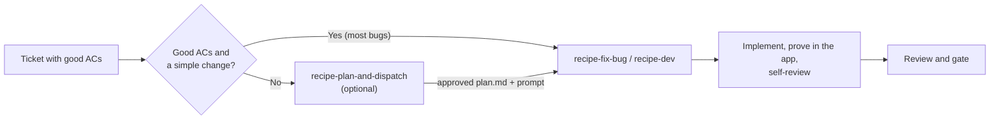

# Recipe skills: how they fit together

The recipe skills take a ticket to a reviewed change with proof from the running app. Each one is invoked by name, and the engineer picks the agent and model for each stage.

## Before you start

Run the skills on a current checkout: update to the latest default branch and run the repository's install (`yarn install`) first. An agent that starts on a stale branch or missing dependencies spends tokens fixing setup instead of the task. `recipe-cook` warns when the checkout is behind.

After an update or install, launch the app once yourself (`mm-harness launch ios` or `android` on Mobile) before starting a skill. The first JavaScript bundle after a dependency change is cold and can take several minutes; paying that up front keeps it out of the task. In Mobile, `yarn install` also re-syncs installed skills, so install a skills branch after it, not before.

## Stages

| Stage | Skill | Output |
|---|---|---|
| Ticket with good acceptance criteria | Team ticket skills, for example `perps-write-ticket` | Specific, testable criteria. The rest of the pipeline proves them. |
| Plan (optional) | `recipe-plan-and-dispatch` | `temp/plans/<ticket>/plan.md` approved by the engineer, and the command that starts the run with its sha256 |
| Implement and verify | `recipe-fix-bug`, `recipe-dev` (both run `recipe-cook`) | Local change, recipe proof in the app, tests, self-review and domain review, per the execution checklist |
| Review and gate | Team review skill, optional final review in `recipe-plan-and-dispatch` | Findings and a verdict. A person reviews and merges. |

Other entry points: `recipe-qa` validates someone else's change, `recipe-performance` measures runtime behavior, `recipe-pretty-pr` packages evidence into a PR description, `recipe-setup` and `recipe-harness` prepare the checkout and runtime.

The full flow, with details per stage (planning and plan handoff, proof in the app, review), is on the mm-harness site: `site/how-it-works.html` in MetaMask/experimental-metamask-harness.
